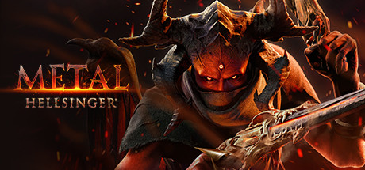

**Metal: Hellsinger is a rhythm FPS where shooting to the beat of a heavy metal soundtrack multiplies your damage and builds your Fury meter. Features licensed metal tracks with real artists and eight realms of increasingly challenging demonic combat.**

---

## 📖 About

Metal: Hellsinger is a rhythm FPS where shooting to the beat of a heavy metal soundtrack multiplies your damage and builds your Fury meter. Features licensed metal tracks with real artists and eight realms of increasingly challenging demonic combat.

## ⚠️ Problems Without Trainer

| Problem | Status |
|---------|--------|
| **Rhythm Dependency** — Off-beat shooting dramatically reduces damage output effectiveness | ✅ Solved |
| **Fury Meter Loss** — Missing the beat resets your power multiplier requiring full rebuild | ✅ Solved |
| **Sigil Unlocking** — Unlocking all sigil slots requires completing story with specific conditions | ✅ Solved |
| **Skull Scores** — Getting top skull scores requires perfect-beat extended combat chains | ✅ Solved |

## ✅ Solution

The **Metal: Hellsinger Trainer** solves all these issues by giving you complete control over the game.

## 🎯 Full Feature List

- Unlimited Resources
- God Mode / Invincibility
- Instant Skill Cooldown
- One-Hit Kill
- Freeze Game Timer
- Unlock All Items & Achievements
- Custom Speed Multiplier
- Save State Anywhere

## 🚀 Quick Start

1. **Disable Windows Defender** temporarily (trainer may trigger false positive)
2. Download the trainer from the button above
3. Launch Metal: Hellsinger
4. Run the trainer as Administrator
5. Activate desired cheats with hotkeys

## 💎 Free vs Paid

| Feature | Free | Pro |
|---------|------|-----|
| Basic God Mode | ✅ | ✅ |
| Unlimited Resources | ✅ | ✅ |
| All Advanced Cheats | ❌ | ✅ |
| Auto-Updates | ❌ | ✅ |
| Priority Support | ❌ | ✅ |

## 💻 Requirements

- Windows 10/11 (64-bit)
- Metal: Hellsinger (any version)
- .NET Framework 4.8+
- DirectX 11+

## 🍎 macOS

macOS users can use our alternative tool:

## ⚖️ Legal

This trainer is for educational and single-player use only. Use responsibly.

---

